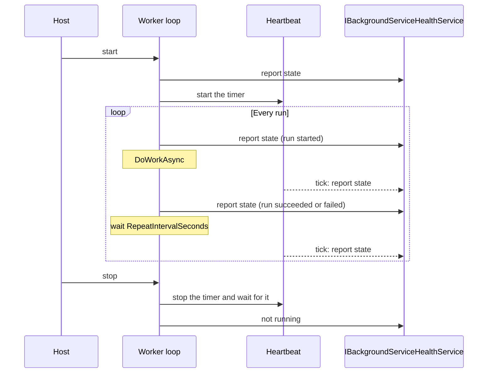
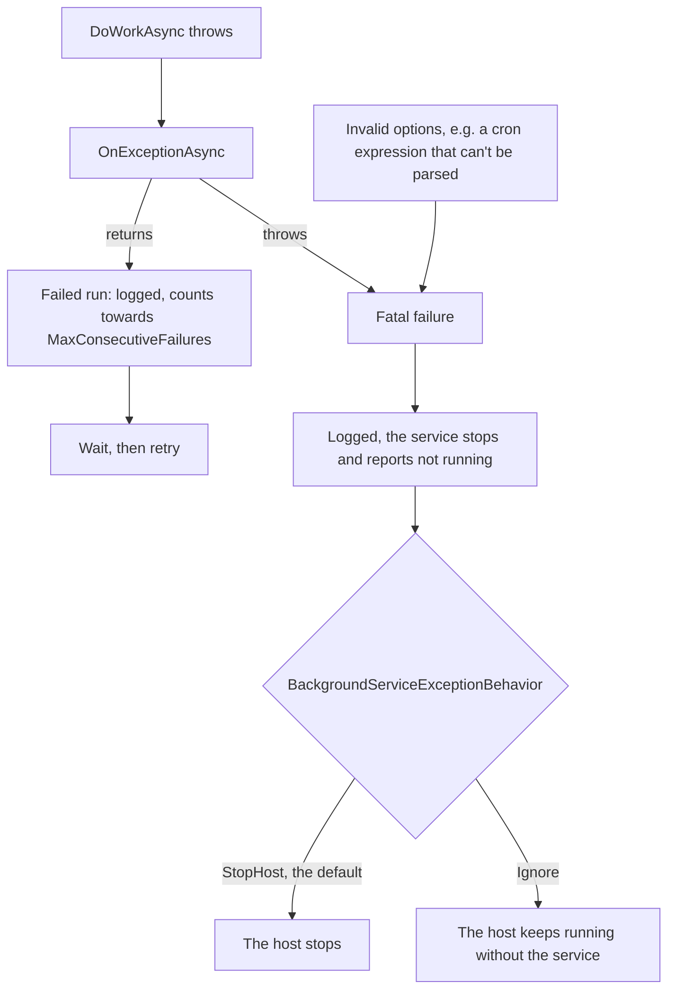

[](https://www.nuget.org/packages/atc.hosting)

# Atc.Hosting

The Atc.Hosting namespace serves as a toolbox for building scalable and reliable hosting solutions, with an emphasis on background services. It contains classes and extension methods designed to handle common hosting scenarios, providing enhanced features like custom logging, and advanced configuration options. The namespace aims to streamline development efforts and improve the maintainability of hosted applications.

> Upgrading from 2.x? See [Upgrading to 3.0](#upgrading-to-30).

# Table of Contents

- [Atc.Hosting](#atchosting)
- [Table of Contents](#table-of-contents)
- [BackgroundServiceBase`<T>`](#backgroundservicebaset)
- [BackgroundScheduleServiceBase`<T>`](#backgroundscheduleservicebaset)
  - [Cron format](#cron-format)
  - [Features](#features)
  - [Sample Usage](#sample-usage)
- [Registering background services](#registering-background-services)
  - [What gets registered](#what-gets-registered)
  - [Options](#options)
  - [Rules](#rules)
  - [Before and after](#before-and-after)
  - [Services registered with AddHostedService](#services-registered-with-addhostedservice)
- [Enabling and disabling background services](#enabling-and-disabling-background-services)
- [BackgroundServiceHealthService](#backgroundservicehealthservice)
  - [Methods](#methods)
  - [Setup via Dependency Injection](#setup-via-dependency-injection)
  - [Using in Background Services](#using-in-background-services)
- [Health, heartbeat and hung runs](#health-heartbeat-and-hung-runs)
  - [The heartbeat](#the-heartbeat)
  - [The two red flags](#the-two-red-flags)
  - [What catches what](#what-catches-what)
  - [Before and after: one long run](#before-and-after-one-long-run)
- [Health checks (Atc.Hosting.HealthChecks)](#health-checks-atchostinghealthchecks)
- [Hosting behaviour](#hosting-behaviour)
  - [Startup](#startup)
  - [Shutdown](#shutdown)
  - [IHostedLifecycleService](#ihostedlifecycleservice)
- [Failures and BackgroundServiceExceptionBehavior](#failures-and-backgroundserviceexceptionbehavior)
  - [Retry or fatal](#retry-or-fatal)
  - [What the host does with a fatal failure](#what-the-host-does-with-a-fatal-failure)
  - [Recommended approach](#recommended-approach)
  - [Exit code on .NET 10](#exit-code-on-net-10)
  - [When to choose Ignore](#when-to-choose-ignore)
- [Complete TimeFileWorker example](#complete-timefileworker-example)
- [Complete TimeFileScheduleWorker example](#complete-timefilescheduleworker-example)
- [Extensions for ServiceProvider](#extensions-for-serviceprovider)
  - [Using GetHostedService`<T>`](#using-gethostedservicet)
- [Upgrading to 3.0](#upgrading-to-30)
  - [Changes that need code changes](#changes-that-need-code-changes)
  - [Changes in behaviour](#changes-in-behaviour)
- [Requirements](#requirements)
- [How to contribute](#how-to-contribute)

# BackgroundServiceBase`<T>`

The `BackgroundServiceBase<T>` class serves as a base for continuous long running background services that require enhanced features like custom logging and configurable service options.
It extends the ASP.NET Core's `BackgroundService` class, providing a more robust framework for handling background tasks.

This class is based on repeat intervals: it runs `DoWorkAsync`, waits `RepeatIntervalSeconds`, and runs it again.

# BackgroundScheduleServiceBase`<T>`

The `BackgroundScheduleServiceBase<T>` class serves as a base for continuous long running background services that require enhanced features like custom logging and configurable service options.
It extends the ASP.NET Core's `BackgroundService` class, providing a more robust framework for handling background tasks.

This class is based on cron expression for scheduling.

- More information about cron expressions can be found on [wiki](https://en.wikipedia.org/wiki/Cron)
- To get help with defining a cron expression, use this [cron online helper](https://crontab.cronhub.io/)

## Cron format

Cron expression is a mask to define fixed times, dates and intervals.
The mask consists of second (optional), minute, hour, day-of-month, month and day-of-week fields.
All of the fields allow you to specify multiple values, and any given date/time will satisfy the specified Cron expression, if all the fields contain a matching value.

```
                                       Allowed values    Allowed special characters   Comment

┌───────────── second (optional)       0-59              * , - /                      
│ ┌───────────── minute                0-59              * , - /                      
│ │ ┌───────────── hour                0-23              * , - /                      
│ │ │ ┌───────────── day of month      1-31              * , - / L W ?                
│ │ │ │ ┌───────────── month           1-12 or JAN-DEC   * , - /                      
│ │ │ │ │ ┌───────────── day of week   0-6  or SUN-SAT   * , - / # L ?                Both 0 and 7 means SUN
│ │ │ │ │ │
* * * * * *
```

## Features

### Logging

- Utilizes `ILogger<T>` for type-specific, high-performance logging.
- Automatically enriches log entries with the name of the service.

### Error Handling

- Catches exceptions from `DoWorkAsync`, passes them to `OnExceptionAsync`, and retries after the `repeat interval` for `BackgroundServiceBase` or at the next occurrence for `BackgroundScheduleServiceBase`.
- The default `OnExceptionAsync` logs the exception with a severity of `LogLevel.Error`. Override it for your own error handling.
- Throwing from `OnExceptionAsync` makes the failure fatal and hands it to the host. See [Failures and BackgroundServiceExceptionBehavior](#failures-and-backgroundserviceexceptionbehavior).

### Configuration Options

- `Enabled` turns a service on or off. See [Enabling and disabling background services](#enabling-and-disabling-background-services).
- Allows for `startup delays` for `BackgroundServiceBase`.
- Configurable `repeat interval` for running tasks with `BackgroundServiceBase`.
- Configurable `cron expression` for scheduling running tasks with `BackgroundScheduleServiceBase`.
- `MaxWorkDurationSeconds` and `MaxConsecutiveFailures` report a hung or failing service as unhealthy. See [Health, heartbeat and hung runs](#health-heartbeat-and-hung-runs).

### Health

- Reports the running state to `IBackgroundServiceHealthService` with a heartbeat, so your worker doesn't have to.
- One call registers the service, its options and its health wiring. See [Registering background services](#registering-background-services).

### Ease of Use

- Simple to derive from and implement your work in the `DoWorkAsync` method.
- All delays and clock reads go through `TimeProvider`, so tests can control time with `FakeTimeProvider`.

## Sample Usage

```csharp
public class MyBackgroundService : BackgroundServiceBase<MyBackgroundService>
{
    public MyBackgroundService(
        ILogger<MyBackgroundService> logger,
        IOptions<MyBackgroundServiceOptions> options,
        IBackgroundServiceHealthService healthService)
        : base(
            logger,
            options.Value,
            healthService)
    {
    }

    public override Task DoWorkAsync(CancellationToken stoppingToken)
    {
        // Your background task logic here
        return Task.CompletedTask;
    }
}

public class MyBackgroundServiceOptions : DefaultBackgroundServiceOptions
{
    public const string SectionName = "MyBackgroundService";
}
```

```csharp
public class MyScheduleService : BackgroundScheduleServiceBase<MyScheduleService>
{
    public MyScheduleService(
        ILogger<MyScheduleService> logger,
        IOptions<MyScheduleServiceOptions> options,
        IBackgroundServiceHealthService healthService)
        : base(
            logger,
            options.Value,
            healthService)
    {
    }

    public override Task DoWorkAsync(CancellationToken stoppingToken)
    {
        // Your background task logic here
        return Task.CompletedTask;
    }
}

public class MyScheduleServiceOptions : DefaultBackgroundScheduleServiceOptions
{
    public const string SectionName = "MyScheduleService";
}
```

Both base classes also take an optional `TimeProvider` as the last constructor argument; `TimeProvider.System` is used when it's left out.

# Registering background services

Register a service, its options and its health wiring with one call:

```csharp
var builder = Host.CreateApplicationBuilder(args);

builder.Services.AddBackgroundService<MyBackgroundService, MyBackgroundServiceOptions>(
    builder.Configuration.GetSection(MyBackgroundServiceOptions.SectionName));

builder.Services.AddBackgroundScheduleService<MyScheduleService, MyScheduleServiceOptions>(
    builder.Configuration.GetSection(MyScheduleServiceOptions.SectionName));

await builder.Build().RunAsync();
```

```json
{
  "MyBackgroundService": {
    "Enabled": true,
    "StartupDelaySeconds": 1,
    "RepeatIntervalSeconds": 60,
    "MaxWorkDurationSeconds": 600,
    "MaxConsecutiveFailures": 5
  },
  "MyScheduleService": {
    "CronExpression": "0 2 * * *"
  }
}
```

The options are bound onto the defaults of `new TOptions()`, so a missing section or a missing value uses the defaults.
To bind and validate the options yourself, pass the instance instead: `AddBackgroundService<MyBackgroundService, MyBackgroundServiceOptions>(options)`.

## What gets registered

| | `Enabled` is `true` | `Enabled` is `false` |
|---|---|---|
| The options, as `TOptions` and through `IOptions`, `IOptionsMonitor` and `IOptionsSnapshot`, bound once (see [Options](#options)) | ✅ | ✅ |
| The hosted service | ✅ | ❌ |
| A `BackgroundServiceRegistration` (read by the health service and the health checks) | ✅ | ❌ |
| `IBackgroundServiceHealthService` with the service's max staleness, and `TimeProvider.System` | ✅ (if not already registered) | ❌ |

A disabled service only gets its options, so other code that injects them keeps working.

## Options

- **Bound once.** The values are bound when the service is registered and don't reload when the configuration changes. `IOptionsMonitor<TOptions>` and `IOptionsSnapshot<TOptions>` return the same values and never report a change; they are registered so code that injects them gets the bound values instead of defaults.
- **`Configure` is ignored.** `services.Configure<TOptions>(...)` and `PostConfigure` don't run for these options, because the instance is already bound.
- **Validators run.** Validators registered with `AddOptions<TOptions>().Validate(...)`, `ValidateDataAnnotations()` or `ValidateOnStart()` run as usual, whether they are added before or after the registration.

## Rules

Each of these throws `InvalidOperationException` when the service is registered:

- **Two services with the same name.** The name is `ServiceName`, or the name of the service class when that isn't set.
- **The same service class twice**, even under different names.
- **Two services with the same options type**, even when one is disabled. The options are registered once per type, so each service needs its own options type.

## Before and after

```csharp
// 2.x
services.Configure<TimeFileWorkerOptions>(configuration.GetSection(TimeFileWorkerOptions.SectionName));
services.AddHostedService<TimeFileWorker>();
services.AddSingleton<IBackgroundServiceHealthService, BackgroundServiceHealthService>(s =>
{
    var healthService = new BackgroundServiceHealthService(s.GetRequiredService<ITimeProvider>());
    var timeFileWorkerOptions = s.GetRequiredService<IOptions<TimeFileWorkerOptions>>().Value;
    healthService.SetMaxStalenessInSeconds(nameof(TimeFileWorker), timeFileWorkerOptions.RepeatIntervalSeconds);
    return healthService;
});

// 3.0
services.AddBackgroundService<TimeFileWorker, TimeFileWorkerOptions>(
    configuration.GetSection(TimeFileWorkerOptions.SectionName));
```

## Services registered with AddHostedService

For services you keep registering with plain `AddHostedService<T>()`, `AddBackgroundServiceHealthService` replaces the hand-written health service lambda:

```csharp
services.AddHostedService<OldWorker>();

services.AddBackgroundServiceHealthService(
    (nameof(OldWorker), 30));
```

It registers the health service and `TimeProvider.System` if they aren't registered yet, and the max staleness in seconds for each name.
It can be called together with `AddBackgroundService`, in any order. A name that is already registered throws `InvalidOperationException`.

A host that registers its own `IBackgroundServiceHealthService` keeps it, and then has to apply the max staleness itself.

# Enabling and disabling background services

Set `Enabled` to `false` to turn a service off without a code change:

```json
{
  "MyBackgroundService": {
    "Enabled": false
  }
}
```

Or with an environment variable, for example in a deployment: `MyBackgroundService__Enabled=false`.
That needs the options to be bound from configuration that includes environment variables, such as `builder.Configuration`.

- **Registered with `AddBackgroundService`:** a disabled service isn't registered as a hosted service at all, and it gets no health check.
- **Registered with plain `AddHostedService<T>()`:** the base class checks `Enabled` when it starts, logs that the service is disabled (event 20006) and returns without doing any work.
  The service never reports itself as running, so a health check for it shows it as unhealthy.

`Enabled` is read once, when the app starts. Changing it while the app runs has no effect until the next restart.

`Enabled` defaults to `true` in `DefaultBackgroundServiceOptions` and `DefaultBackgroundScheduleServiceOptions`.

# BackgroundServiceHealthService

`IBackgroundServiceHealthService` is an interface that provides methods to manage and monitor the health of background services in a .NET application.

## Methods

- `SetMaxStalenessInSeconds(string serviceName, ushort seconds)`: Set the maximum allowed staleness duration for a service in seconds.
- `SetRunningState(string serviceName, bool isRunning)`: Update the running state of a service.
- `IsServiceRunning(string serviceName)`: Check if a service is running or not: the last reported state was "running", and it was reported within the max staleness, when one is set.

## Setup via Dependency Injection

`AddBackgroundService` and `AddBackgroundScheduleService` register the health service and apply each service's max staleness.
For services registered with plain `AddHostedService<T>()`, use [`AddBackgroundServiceHealthService`](#services-registered-with-addhostedservice).

To create it yourself, pass a `TimeProvider`:

```csharp
var healthService = new BackgroundServiceHealthService(TimeProvider.System);
```

## Using in Background Services

Services that derive from `BackgroundServiceBase<T>` or `BackgroundScheduleServiceBase<T>` and get `IBackgroundServiceHealthService` in their constructor report their running state themselves:

- "running" when the service starts, before and after each run, and on every heartbeat;
- "not running" when a red flag is up (see [The two red flags](#the-two-red-flags));
- "not running" when the service stops.

**Don't call `SetRunningState` from these services.** A manual "running" overrides `MaxWorkDurationSeconds` and `MaxConsecutiveFailures` until the next heartbeat corrects it.
To make a service report unhealthy on purpose, throw from `DoWorkAsync` and set `MaxConsecutiveFailures`.

Reading the state is fine, for example to check another service:

```csharp
var isRunning = healthService.IsServiceRunning(nameof(TimeFileWorker));
```

Services that don't use the base classes report their state themselves:

```csharp
public override async Task StartAsync(CancellationToken cancellationToken)
{
    await base.StartAsync(cancellationToken);
    healthService.SetRunningState(nameof(OldWorker), isRunning: true);
}

public override async Task StopAsync(CancellationToken cancellationToken)
{
    await base.StopAsync(cancellationToken);
    healthService.SetRunningState(nameof(OldWorker), isRunning: false);
}

// Inside the work loop, to update the timestamp the max staleness is measured from:
healthService.SetRunningState(nameof(OldWorker), isRunning: true);
```

# Health, heartbeat and hung runs

## The heartbeat

While a service runs, a heartbeat reports its state at a fixed interval, also during a long run and while a schedule service waits for its next occurrence.
The max staleness is three heartbeat intervals, so two missed heartbeats are tolerated. `AddBackgroundService` and `AddBackgroundScheduleService` apply it automatically.

| Service | Heartbeat interval | Max staleness |
|---|---|---|
| `BackgroundServiceBase`, `RepeatIntervalSeconds` = 1–3 | 1 s | 3 s |
| `BackgroundServiceBase`, `RepeatIntervalSeconds` = 10 | 5 s | 15 s |
| `BackgroundServiceBase`, `RepeatIntervalSeconds` ≥ 20 | 10 s | 30 s |
| `BackgroundScheduleServiceBase`, any cron expression | 10 s | 30 s |

The interval is half of `RepeatIntervalSeconds`, between 1 and 10 seconds. A 1 second grace period is added to the staleness.



"Report state" means "running", unless a red flag is up.
The heartbeat is stopped before the final "not running", so a late tick can't report a stopped service as running.

## The two red flags

**Healthy = no red flag up.** Each flag is off by default and turned on by its option. Both log a warning when they go up (events 20007 and 20009).

**`MaxWorkDurationSeconds`: a run that takes too long.** For example, with `MaxWorkDurationSeconds` = 600 and one run that takes 15 minutes:

| Time since the run started | 0–10 min | 10–15 min | 15 min: the run ends |
|---|---|---|---|
| Reported | running | **not running** | running |

The flag goes up on the first heartbeat after the limit, so within 10 seconds. The run itself isn't cancelled.

**`MaxConsecutiveFailures`: runs that fail one after another.** A failed run is one where `DoWorkAsync` throws and `OnExceptionAsync` returns, so the run is retried. For example, with `MaxConsecutiveFailures` = 3:

| Run | 1 | 2 | 3 | 4 | 5 | 6 |
|---|---|---|---|---|---|---|
| Result | ✅ ok | ❌ failed | ❌ failed | ❌ failed | ❌ failed | ✅ ok |
| Failures in a row | 0 | 1 | 2 | 3 | 4 | 0 |
| Reported | running | running | running | **not running** | **not running** | running |

## What catches what

| Problem | Reported as not running | Without it |
|---|---|---|
| A run hangs | With `MaxWorkDurationSeconds`, once the run passes it | ⚠️ Stays healthy |
| Every run fails | With `MaxConsecutiveFailures`, once the failures in a row reach it | ⚠️ Stays healthy |
| The service stops, or fails fatally | Always, right away | |
| The heartbeat stops without a final report | With a max staleness, once it has passed. `AddBackgroundService` sets it automatically | ⚠️ Stays healthy |

These are never reported as not running: a long run that stays below `MaxWorkDurationSeconds`, and a schedule service waiting for its next occurrence.

**Without the two limits, a hung or always-failing worker stays healthy.** Set `MaxWorkDurationSeconds` above your longest legitimate run, and `MaxConsecutiveFailures` to the number of failures you're willing to see before an alert.

## Before and after: one long run

`RepeatIntervalSeconds` is 60. A legitimate run takes 3 minutes, the service waits 1 minute, and the next run hangs.

```
                           0     3     6     9     12    15 min
Runs                       LLLLLLwwHHHHHHHHHHHHHHHHHHHHHH
2.x, staleness 60 s        ██░░░░████░░░░░░░░░░░░░░░░░░░░
3.0, no limits             ██████████████████████████████
3.0, MaxWorkDuration 600   ████████████████████████████░░

L legitimate run   w wait   H hung run   █ running   ░ not running   (one character = 30 seconds)
```

- **2.x** raises a false alarm during the legitimate run, and the hung run looks exactly the same.
- **3.0 without limits** stays healthy through both, so the hung run is never detected.
- **3.0 with `MaxWorkDurationSeconds` = 600** stays healthy through the legitimate run, and reports the hung run 10 minutes after it started.

# Health checks (Atc.Hosting.HealthChecks)

The `Atc.Hosting.HealthChecks` package adds one ASP.NET Core health check per background service, named after the service:

```csharp
using Atc.Hosting.HealthChecks;

services
    .AddHealthChecks()
    .AddBackgroundServices(tags: ["dependency"]);
```

It adds a check for every service registered with `AddBackgroundService` or `AddBackgroundScheduleService`, and it can be called before or after those calls. Disabled services get no check.
For services registered with plain `AddHostedService<T>()`, pass the names: `.AddBackgroundServices([nameof(OldWorker)])`.

See the [Atc.Hosting.HealthChecks README](src/Atc.Hosting.HealthChecks/README.md) for the options and messages.

# Hosting behaviour

## Startup

- **`ExecuteAsync` never blocks.** Since .NET 10, the host runs all of `ExecuteAsync` on a background thread, so a slow or synchronous start of one worker doesn't delay the other services or the application.
- **`StartAsync` overrides still do.** The host waits for `StartAsync`, so keep an override short and call `base.StartAsync`.
- **Concurrency.** By default, the host starts and stops hosted services one after another. `HostOptions.ServicesStartConcurrently` and `HostOptions.ServicesStopConcurrently` make it start or stop them in parallel:

```csharp
services.Configure<HostOptions>(options =>
{
    options.ServicesStartConcurrently = true;
    options.ServicesStopConcurrently = true;
});
```

## Shutdown

When the host stops, it cancels the `stoppingToken` and waits for the services to stop, at most `HostOptions.ShutdownTimeout` (30 seconds by default).

- **Pass `stoppingToken` on to every asynchronous call in `DoWorkAsync`**, and return promptly when it's cancelled.
- A service that hasn't stopped when the host gives up logs a warning (event 20008), usually because `DoWorkAsync` ignores the token. The host then stops without waiting for it.
- To give long runs more time to finish:

```csharp
services.Configure<HostOptions>(options => options.ShutdownTimeout = TimeSpan.FromSeconds(60));
```

For failures, see [Failures and BackgroundServiceExceptionBehavior](#failures-and-backgroundserviceexceptionbehavior).

## IHostedLifecycleService

A worker that derives from the base classes can also implement `IHostedLifecycleService` (.NET 8 and later). The host calls its hooks around `StartAsync` and `StopAsync`:

```csharp
public class MyBackgroundService : BackgroundServiceBase<MyBackgroundService>, IHostedLifecycleService
{
    // ...constructor and DoWorkAsync as usual

    public Task StartingAsync(CancellationToken cancellationToken) => Task.CompletedTask; // before any service starts
    public Task StartedAsync(CancellationToken cancellationToken) => Task.CompletedTask;  // after all services have started
    public Task StoppingAsync(CancellationToken cancellationToken) => Task.CompletedTask; // before any service stops
    public Task StoppedAsync(CancellationToken cancellationToken) => Task.CompletedTask;  // after all services have stopped
}
```

# Failures and BackgroundServiceExceptionBehavior

## Retry or fatal



- **Retry.** An exception from `DoWorkAsync` goes to `OnExceptionAsync`. When that returns, the service waits and retries. This never stops the host.
- **Fatal.** A failure is fatal only when it escapes the loop: `OnExceptionAsync` throws (or returns a faulted task), or the options are invalid. The service logs it (event 20004), stops, and passes the exception to the host.

A cancelled `stoppingToken` during shutdown is neither: the service just stops.

## What the host does with a fatal failure

`HostOptions.BackgroundServiceExceptionBehavior` decides, for every background service in the host:

| Value | What happens |
|---|---|
| `StopHost` (default) | The host stops. |
| `Ignore` | The service is stopped and reports not running. The host keeps running without it. |

```csharp
services.Configure<HostOptions>(options =>
    options.BackgroundServiceExceptionBehavior = BackgroundServiceExceptionBehavior.Ignore);
```

## Recommended approach

- **Keep `StopHost`, and let the platform restart the process**: Kubernetes, Azure Container Apps, App Service, or a Windows Service with recovery actions. A fresh process is usually the most reliable recovery.
- **Retry what you can recover from.** Return from `OnExceptionAsync`, and set `MaxConsecutiveFailures` so a failure that keeps coming back shows up as unhealthy.
- **Escalate what you can't recover from** by throwing from `OnExceptionAsync`:

```csharp
protected override Task OnExceptionAsync(
    Exception exception,
    CancellationToken stoppingToken)
{
    if (exception is UnauthorizedAccessException)
    {
        return Task.FromException(exception); // fatal
    }

    return base.OnExceptionAsync(exception, stoppingToken); // log and retry
}
```

- **Don't call `StopAsync` on the worker itself.** It stops only that worker, leaves the host running without it, and looks like a clean stop.
  To shut down the whole application on purpose, use `IHostApplicationLifetime.StopApplication()`.

## Exit code on .NET 10

On .NET 10, a host stopped by `StopHost` exits with code 0. Restart policies that only react to failures, such as Docker's `on-failure` or the Windows Service recovery actions, then don't restart it.
To exit with a failure code, check the services after `RunAsync`:

```csharp
var host = builder.Build();

// RunAsync disposes the host, so get the services before it runs.
var backgroundServices = host.Services
    .GetServices<IHostedService>()
    .OfType<BackgroundService>()
    .ToList();

await host.RunAsync();

return backgroundServices.Any(s => s.ExecuteTask is { IsFaulted: true }) ? 1 : 0;
```

.NET 11 makes `RunAsync` throw the exception instead, so the process exits with a failure code without this.

## When to choose Ignore

Choose `Ignore` for a host whose main job must keep running when an auxiliary worker dies, typically an API.
Then wire up [Atc.Hosting.HealthChecks](#health-checks-atchostinghealthchecks), so the dead worker shows up as unhealthy.

The setting applies to the whole host: it also keeps a plain `BackgroundService` in the same host from stopping it.

# Complete TimeFileWorker example

A sample reference implementation can be found in the sample project [`Atc.Hosting.TimeFile.Sample`](sample/Atc.Hosting.TimeFile.Sample/Program.cs)
which shows an example of the service `TimeFileWorker` that uses `BackgroundServiceBase` and the `IBackgroundServiceHealthService`.

```csharp
public class TimeFileWorker : BackgroundServiceBase<TimeFileWorker>
{
    private readonly TimeFileWorkerOptions workerOptions;

    public TimeFileWorker(
        ILogger<TimeFileWorker> logger,
        IBackgroundServiceHealthService healthService,
        TimeProvider timeProvider,
        IOptions<TimeFileWorkerOptions> workerOptions)
        : base(
            logger,
            workerOptions.Value,
            healthService,
            timeProvider)
    {
        this.workerOptions = workerOptions.Value;
    }

    public override Task StartAsync(CancellationToken cancellationToken)
    {
        logger.LogInformation("Started");
        return base.StartAsync(cancellationToken);
    }

    public override Task StopAsync(CancellationToken cancellationToken)
    {
        logger.LogInformation("Stopped");
        return base.StopAsync(cancellationToken);
    }

    public override Task DoWorkAsync(CancellationToken stoppingToken)
    {
        var isServiceRunning = healthService.IsServiceRunning(nameof(TimeFileWorker));

        Directory.CreateDirectory(workerOptions.OutputDirectory);

        var time = TimeProvider.GetUtcNow();

        var outFile = Path.Combine(
            workerOptions.OutputDirectory,
            $"{nameof(TimeFileWorker)}.txt");

        return File.AppendAllLinesAsync(
            outFile,
            [$"{time:yyyy-MM-dd HH:mm:ss} - {ServiceName} - IsRunning={isServiceRunning}"],
            stoppingToken);
    }

    protected override Task OnExceptionAsync(
        Exception exception,
        CancellationToken stoppingToken)
    {
        if (exception is IOException or UnauthorizedAccessException)
        {
            logger.LogCritical(exception, "Could not write file!");
            return Task.FromException(exception);
        }

        return base.OnExceptionAsync(exception, stoppingToken);
    }
}
```

The sample registers both workers in `Program.cs`:

```csharp
services.AddSingleton(TimeProvider.System);

services.AddBackgroundService<TimeFileWorker, TimeFileWorkerOptions>(
    configuration.GetSection(TimeFileWorkerOptions.SectionName));

services.AddBackgroundScheduleService<TimeFileScheduleWorker, TimeFileScheduleWorkerOptions>(
    configuration.GetSection(TimeFileScheduleWorkerOptions.SectionName));
```

# Complete TimeFileScheduleWorker example

A sample reference implementation can be found in the sample project [`Atc.Hosting.TimeFile.Sample`](sample/Atc.Hosting.TimeFile.Sample/Program.cs)
which shows an example of the service `TimeFileScheduleWorker` that uses `BackgroundScheduleServiceBase` and the `IBackgroundServiceHealthService`.

```csharp
public class TimeFileScheduleWorker : BackgroundScheduleServiceBase<TimeFileScheduleWorker>
{
    private readonly TimeFileScheduleWorkerOptions workerOptions;

    public TimeFileScheduleWorker(
        ILogger<TimeFileScheduleWorker> logger,
        IBackgroundServiceHealthService healthService,
        TimeProvider timeProvider,
        IOptions<TimeFileScheduleWorkerOptions> workerOptions)
        : base(
            logger,
            workerOptions.Value,
            healthService,
            timeProvider)
    {
        this.workerOptions = workerOptions.Value;
    }

    public override Task StartAsync(CancellationToken cancellationToken)
    {
        logger.LogInformation("Started");
        return base.StartAsync(cancellationToken);
    }

    public override Task StopAsync(CancellationToken cancellationToken)
    {
        logger.LogInformation("Stopped");
        return base.StopAsync(cancellationToken);
    }

    public override Task DoWorkAsync(CancellationToken stoppingToken)
    {
        var isServiceRunning = healthService.IsServiceRunning(nameof(TimeFileWorker));

        Directory.CreateDirectory(workerOptions.OutputDirectory);

        var time = TimeProvider.GetUtcNow();

        var outFile = Path.Combine(
            workerOptions.OutputDirectory,
            $"{nameof(TimeFileWorker)}.txt");

        return File.AppendAllLinesAsync(
            outFile,
            [$"{time:yyyy-MM-dd HH:mm:ss} - {ServiceName} - IsRunning={isServiceRunning}"],
            stoppingToken);
    }

    protected override Task OnExceptionAsync(
        Exception exception,
        CancellationToken stoppingToken)
    {
        if (exception is IOException or UnauthorizedAccessException)
        {
            logger.LogCritical(exception, "Could not write file!");
            return Task.FromException(exception);
        }

        return base.OnExceptionAsync(exception, stoppingToken);
    }
}
```

# Extensions for ServiceProvider

Defined extensions methods for ServiceProvider:
> GetHostedService`<T>`

## Using GetHostedService`<T>`

Example on how to retrieve the BackgroundService from the HttpContext in a MVC controller or MinimalApi endpoint.

In this example we are working with the `TimeFileWorker` BackgroundService.

Note: Remember to register the BackgroundService in `Program.cs`, e.g. with `services.AddBackgroundService<TimeFileWorker, TimeFileWorkerOptions>(...)`.
A disabled service isn't registered as a hosted service, so `GetHostedService<T>()` returns `null` for it.

Example setup for a MVC controller:

```csharp
[HttpGet("my-method")]
public void GetMyMethod()
{
    var timeFileWorker = httpContext.RequestServices.GetHostedService<TimeFileWorker>();

    if (timeFileWorker is not null)
    {
      // Here we have access to the TimeFileWorker instance.
    }
}
```

Example setup for a MinimalApi endpoint:

```csharp
public void DefineEndpoints(WebApplication app)
{
    app.MapGet("my-method", async httpContext =>
    {
        var timeFileWorker = httpContext.RequestServices.GetHostedService<TimeFileWorker>();

        if (timeFileWorker is not null)
        {
          // Here we have access to the TimeFileWorker instance.
        }

        await Task.CompletedTask;
    });
}
```

# Upgrading to 3.0

3.0 moves to .NET 10 and `System.TimeProvider`, reports health with a heartbeat, and lets fatal failures stop the host. Go through this list when you upgrade from 2.x.

## Changes that need code changes

**.NET 10.** Atc.Hosting 3.0 targets `net10.0`.

**New members on the options interfaces.** `IBackgroundServiceBaseOptions` now declares `Enabled`, `MaxWorkDurationSeconds` and `MaxConsecutiveFailures`.
Options types that derive from `DefaultBackgroundServiceOptions` or `DefaultBackgroundScheduleServiceOptions` already have them. Options types that implement `IBackgroundServiceOptions` or `IBackgroundScheduleServiceOptions` directly must add them:

```csharp
// 2.x
public class TimeFileWorkerOptions : IBackgroundServiceOptions
{
    public ushort StartupDelaySeconds { get; set; } = 1;

    public ushort RepeatIntervalSeconds { get; set; } = 20;

    public string? ServiceName { get; set; }
}

// 3.0
public class TimeFileWorkerOptions : IBackgroundServiceOptions
{
    public bool Enabled { get; set; } = true; // without "= true", the service is disabled unless the configuration enables it

    public ushort StartupDelaySeconds { get; set; } = 1;

    public ushort RepeatIntervalSeconds { get; set; } = 20;

    public ushort? MaxWorkDurationSeconds { get; set; }

    public ushort? MaxConsecutiveFailures { get; set; }

    public string? ServiceName { get; set; }
}
```

**`ITimeProvider` is replaced by `System.TimeProvider`.** `ITimeProvider` and `SystemTimeProvider` are removed:

| 2.x | 3.0 |
|---|---|
| `ITimeProvider` | `TimeProvider` |
| `SystemTimeProvider` | `TimeProvider.System` |
| `timeProvider.UtcNow` | `timeProvider.GetUtcNow()` |
| `new BackgroundServiceHealthService(ITimeProvider)` | `new BackgroundServiceHealthService(TimeProvider)` |

The base classes take an optional `TimeProvider` as the last constructor argument, and expose it as the protected `TimeProvider` property.
Atc.Hosting no longer depends on the `Atc` package. If you used `Atc` through Atc.Hosting, add a direct reference to it.

**Stopping on a fatal error.** If your `OnExceptionAsync` calls `StopAsync` to stop the worker, return `Task.FromException(exception)` instead. See [Recommended approach](#recommended-approach).

## Changes in behaviour

**Fatal failures stop the host by default.** In 2.x, a fatal failure was logged and swallowed, and the host kept running without the worker.
In 3.0 it's passed to the host, which applies `BackgroundServiceExceptionBehavior`, by default `StopHost`. See [Failures and BackgroundServiceExceptionBehavior](#failures-and-backgroundserviceexceptionbehavior).
To keep the 2.x behaviour, set `BackgroundServiceExceptionBehavior.Ignore`. That setting applies to the whole host: a plain `BackgroundService` in the same host no longer stops it either, which it did by default before.

**Health is reported with a heartbeat.**

- A long run no longer shows the service as unhealthy.
- A hung run is only detected with `MaxWorkDurationSeconds`. Setting it to `RepeatIntervalSeconds` comes closest to 2.x, where a run longer than the staleness showed as unhealthy.
- A worker that fails on every run is only detected with `MaxConsecutiveFailures`.
- Schedule services get a max staleness when they are registered with `AddBackgroundScheduleService`.
- A host that keeps its own `SetMaxStalenessInSeconds(name, RepeatIntervalSeconds)` keeps working, because the heartbeat reports at least every half repeat interval.
- The base classes report the running state themselves. Remove `SetRunningState` calls from workers that derive from them; see [Using in Background Services](#using-in-background-services).

**Other changes you may notice:**

- New log events: 20006 (the service is disabled), 20007 (a run took longer than `MaxWorkDurationSeconds`), 20008 (the service didn't stop within the shutdown timeout) and 20009 (`MaxConsecutiveFailures` reached).
- The new `AddBackgroundService` and `AddBackgroundScheduleService` replace `Configure<TOptions>`, `AddHostedService<T>()` and the health service lambda. The old registration still works. See [Registering background services](#registering-background-services).

# Requirements

- [.NET 10 SDK](https://dotnet.microsoft.com/en-us/download/dotnet/10.0)

# How to contribute

[Contribution Guidelines](https://atc-net.github.io/introduction/about-atc#how-to-contribute)

[Coding Guidelines](https://atc-net.github.io/introduction/about-atc#coding-guidelines)
